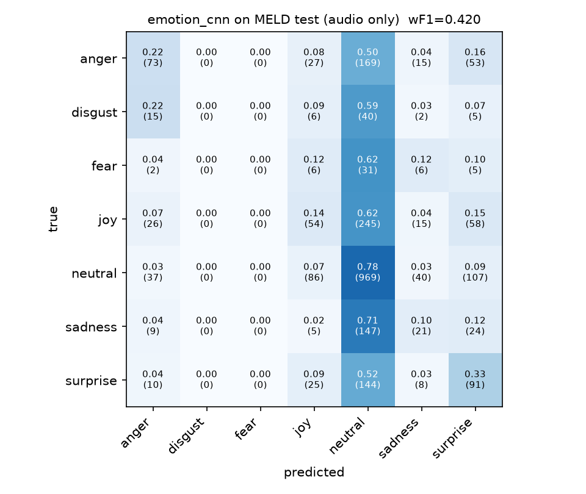

# Pip: real-time, audio-first emotion tagging + reply (MELD)

A small, fully local prototype for an emotion-aware character robot. You talk (or stream a
MELD clip). While you're speaking, Pip shows a **provisional emotion tag** that updates
twice a second. When you stop, it emits a **structured state** (MELD emotion + confidence,
transcript, prosody tags) and **streams a short reply** grounded in what you said *and how
you said it*.

**Track:** Audio (primary). Text appears only as a by-product of the audio: a local Whisper
transcript gives the reply something to answer, and is never used by the emotion classifier.

```
browser mic / MELD clip / file
        │  16 kHz int16 PCM, 100 ms chunks, WebSocket
        ▼
   Silero VAD (32 ms frames) ──► while speaking, every 0.5 s: AudioCNN(last 3 s) ──► partial_state
        │ 500 ms of silence = end of turn
        ▼
   utterance ─┬─ AudioCNN (ours, trained on MELD audio) ┐
              ├─ Whisper-small (MLX)                   ├─► final_state ──► Qwen2.5-3B (MLX) ──► response_delta … response_done
              └─ prosody: pitch / loudness / pace      ┘
```

Everything runs on one laptop. The emotion model was trained locally. No cloud
inference. Total learned parameters on the inference path: **3.35 B of the 6 B limit**
(table [below](#models-and-parameter-budget)).

---

## Contents
1. [Quick start](#quick-start)
2. [Reproduce training](#reproduce-training)
3. [What "real-time" means here](#what-real-time-means-here)
4. [Output format](#output-format)
5. [Models and parameter budget](#models-and-parameter-budget)
6. [Results](#results)
7. [Decisions and trade-offs](#decisions-and-trade-offs)
8. [Limitations](#limitations)
9. [Done vs. intentionally left out](#done-vs-intentionally-left-out)
10. [External components](#external-components)
11. [Repository layout](#repository-layout)

---

## Quick start

Requirements: Apple-Silicon Mac (MLX), Python 3.11/3.12, `ffmpeg` (`brew install ffmpeg`).
First start downloads Whisper-small and Qwen2.5-3B-4bit from Hugging Face (~2.5 GB).

```bash
python3.12 -m venv .venv && source .venv/bin/activate
pip install -r requirements.txt

python -m app.server            # → open http://127.0.0.1:8000
```

In the page: **Start microphone** and talk, or pick a **MELD test clip** and stream it (needs
the data step below), or **stream any audio/video file**. The trained emotion checkpoint
`checkpoints/emotion_cnn.pt` is included, so no training is needed to run the demo.

**One input through the whole system, from the terminal** (server must be running):

```bash
python -m app.replay --clip dia3_utt2         # a MELD test clip, shows ground truth
python -m app.replay path/to/any.wav|mp4|m4a  # anything ffmpeg can read
```

It prints the provisional updates, the final structured state and the streamed reply as they
arrive, and saves the full event trace to `results/traces/<name>.json`. An example trace is
in [`results/example_trace.json`](results/example_trace.json).

Other entry points:

| command | what |
|---|---|
| `python -m tests.test_pipeline` | turn-taking/event-order test with fake models (no downloads) |
| `python -m scripts.count_params` | loads every model and counts parameters → `results/params.json` |
| `python -m scripts.benchmark_latency --n 35` | latency + memory benchmark → `results/benchmark.*` |
| `curl -F file=@clip.wav localhost:8000/api/analyze` | non-streaming debug path (whole file = one utterance) |
| `python -m app.server --no-llm` | template replies instead of the LLM (debugging) |

## Reproduce training

All local (Apple-GPU via PyTorch MPS). ~11 GB download, ~25 GB on disk while extracting.

```bash
# 1. data: the official MELD.Raw archive (Hugging Face mirror of the declare-lab release)
curl -L -C - -o data/MELD.Raw.tar.gz \
  https://huggingface.co/datasets/declare-lab/MELD/resolve/main/MELD.Raw.tar.gz
python -m training.prepare_meld     # extract → 16 kHz mono wav → log-mel cache → manifests

# 2. train three variants (each selects its best epoch on *dev* weighted-F1)
python -m training.train --run-name ce_plain       --class-weighting none
python -m training.train --run-name wce_sqrt       --class-weighting sqrt
python -m training.train --run-name wce_sqrt_mixup --class-weighting sqrt --mixup-prob 0.5

# 3. choose on dev, promote the winner, then touch test exactly once
python -m training.evaluate --split dev  --checkpoints checkpoints/*/best.pt --promote
python -m training.evaluate --split test --checkpoints checkpoints/emotion_cnn.pt
```

`tensorboard --logdir runs` shows the curves. `data/meld/prep_report.json` lists clip
counts, durations and any clips that failed to decode.

## What "real-time" means here

The target interaction is **turn-based conversation with a robot**: one speaker, a natural
pause at the end of each turn. "Real-time" means the robot *visibly listens while you talk*
and *starts answering within about a second of you stopping*, which is roughly the gap
people leave between turns.

| moment | budget | how |
|---|---|---|
| audio transport | 100 ms chunks | browser AudioWorklet → WebSocket |
| provisional emotion while speaking | every 0.5 s, each ≤ 50 ms compute | CNN on the last 3 s of speech |
| end-of-turn detection | 500 ms of silence | Silero VAD with hysteresis |
| final structured state | ≤ 300 ms after end of turn | CNN ∥ Whisper ∥ prosody in parallel |
| first reply word | ≤ 1 s after end of turn | LLM streams token by token |

Assumptions: English speech, one speaker at a time, a laptop microphone at conversational
distance, and the user waits for the reply (no barge-in). The 500 ms end-of-turn silence is
a deliberate trade-off: shorter pauses cut people off mid-sentence, longer ones feel sluggish.
Measured numbers are in [Results](#results).

## Output format

Server → client JSON events on `/ws` (client sends raw int16 PCM; text commands `flush`, `reset`).

`partial_state`: provisional, while the person is still speaking
```json
{"type": "partial_state", "utterance_id": 1, "emotion": "anger", "confidence": 0.47,
 "probs": {"anger": 0.47, "disgust": 0.03, "fear": 0.05, "joy": 0.06, "neutral": 0.29, "sadness": 0.04, "surprise": 0.06},
 "window_s": 2.5, "latency_ms": {"emotion": 14.2}, "stream_t_s": 3.1}
```

`final_state`: the structured state for the whole utterance
```json
{"type": "final_state", "utterance_id": 1, "start_s": 0.62, "duration_s": 2.84,
 "emotion": "anger", "confidence": 0.58, "probs": {"anger": 0.58, "...": 0.0},
 "transcript": "You ate my sandwich?",
 "tags": ["emotion:anger", "loudness:loud", "pitch_variation:animated"],
 "prosody": {"loudness_dbfs": -14.2, "pitch_hz": 221.4, "pitch_variation_st": 4.6, "rate_wps": 2.9,
             "labels": {"loudness": "loud", "pitch": null, "pitch_variation": "animated", "pace": "normal"}},
 "delivery": "louder than usual, animated, varied intonation",
 "latency_ms": {"queue": 0.1, "emotion": 18.0, "asr": 160.0, "parallel_stage": 171.0, "end_of_speech_to_state": 172.0}}
```

`response_delta` (a few characters each) then `response_done`:
```json
{"type": "response_done", "utterance_id": 1, "text": "Oh no, I did not touch it, I promise! Want me to help find out who did?",
 "latency_ms": {"end_of_speech_to_first_token": 410.0, "end_of_speech_to_last_token": 1180.0, "generation": 1000.0},
 "tokens": 24, "tokens_per_s": 31.0}
```
Also: `ready` (config + loaded models), `vad` (`speech_start` / `speech_end` / `discarded`), `error`.
*(Example values above are illustrative. Real traces are in `results/`.)*

## Models and parameter budget

| component | role | source | parameters |
|---|---|---|---:|
| Silero VAD | speech start / end | `silero-vad` pip package | 462,594 |
| **AudioCNN (ours)** | emotion: provisional + final | trained here on MELD | 21,281,991 |
| Whisper small | transcript | `mlx-community/whisper-small-mlx` | 240,582,932 |
| Qwen2.5-3B-Instruct (4-bit) | reply text | `mlx-community/Qwen2.5-3B-Instruct-4bit` | 3,085,938,688 |
| prosody (librosa YIN + RMS) | pitch / loudness / pace tags | hand-written DSP | 0 |
| **total** | | | **3,348,266,205 (3.35 B / 6 B)** |

Measured by `python -m scripts.count_params` on the models as loaded (`results/params.json`).

Counting rule: every learned tensor on the inference path, with 4-bit weights counted as
unpacked parameters (quantisation scales/offsets excluded; see `app/mlx_params.py`).

## Results

### Emotion recognition (audio only, MELD)

**Data.** Official MELD splits. 9,877 train / 1,092 dev / 2,576 test utterances were usable.
Dropped: 161 clips whose audio track is under 0.2 s (broken cuts, e.g. 0.12 s of audio for
*"We have so much in common!"*), one corrupt train video and one missing dev video. Details are
in `data/meld/prep_report.json`. **Because 34 test clips are dropped, the test scores are on
2,576 of the 2,610 utterances.**

**Model selection on dev** (best epoch of each run, by dev weighted F1):

| run | loss | weighted F1 | macro F1 | accuracy |
|---|---|---|---|---|
| majority class (neutral) | n/a | 0.252 | 0.085 | 0.424 |
| `ce_plain` | cross-entropy | 0.390 | 0.218 | 0.465 |
| `wce_sqrt` | 1/√freq class-weighted CE | 0.393 | 0.227 | 0.445 |
| **`wce_sqrt_mixup`** | weighted CE + mixup (p = 0.5) | **0.410** | **0.254** | 0.443 |

Class weighting and mixup both trade a little accuracy for better minority-class F1.
Mixup gave the clearest gain: dev sadness F1 rose from 0.03 to 0.21. That run was promoted
to `checkpoints/emotion_cnn.pt`.

**Held-out test** (evaluated once, after selection):

| model | weighted F1 | macro F1 | accuracy | anger | disgust | fear | joy | neutral | sadness | surprise |
|---|---|---|---|---|---|---|---|---|---|---|
| majority class (neutral) | 0.312 | 0.093 | 0.481 | 0.00 | 0.00 | 0.00 | 0.00 | 0.65 | 0.00 | 0.00 |
| **AudioCNN (ours)** | **0.420** | **0.220** | 0.469 | 0.29 | 0.00 | 0.00 | 0.18 | 0.65 | 0.13 | 0.29 |



How to read this:
- **+10.8 points of weighted F1 over always saying "neutral"**, and macro F1 more than doubles.
- **For reference, not a like-for-like comparison:** the MELD paper's audio-only baselines
  use openSMILE features *plus dialogue context* and report 39.1 (bcLSTM) and 41.8
  (DialogueRNN) test weighted F1 (Poria et al., 2019, Table 11). This model sees one
  utterance at a time. The same paper's text-only baselines reach about 56–57, which is why
  the words are passed to the reply generator.
- **What the model learned:** it is best at the high-arousal classes (anger, surprise).
- **Where it fails:** it never predicts disgust or fear (68 and 50 test examples), and it
  pulls most joy and sadness toward neutral. These are the honest weaknesses of a small,
  from-scratch audio model on TV audio.
- **Training cost:** ~26 s per epoch on the M5 Pro GPU. Each run early-stopped after 34–39
  epochs, about 15–17 minutes.

### Latency and resources

**Core (audio track) system.** `python -m scripts.benchmark_latency --n 35` streams 35 MELD test
clips (5 per emotion) through the full pipeline in real time: VAD, CNN, Whisper, prosody and
the LLM, with every model loaded exactly as the server loads them. The end of a turn is
declared after 500 ms of silence, and the times below are measured *from that point*.

| stage | p50 | p95 | target |
|---|---|---|---|
| final emotion (CNN, whole utterance) | 54 ms | 81 ms | |
| Whisper transcript (runs in parallel with the CNN) | 90 ms | 128 ms | |
| **end of speech → `final_state`** | **91 ms** | **129 ms** | ≤ 300 ms |
| **end of speech → first reply token** | **186 ms** | **240 ms** | ≤ 1 s |
| end of speech → full reply | 310 ms | 372 ms | |
| LLM generation speed | 70 tok/s | 79 tok/s | |

So the robot can start answering ~0.7 s after the person stops talking (0.5 s silence wait
+ 0.19 s), which is within the length of a natural conversational pause.

- **Detection:** speech was detected in 32 of 35 clips. In 3 clips the VAD never fired on the
  TV audio (music/laughter, or very short speech). One clip was split into two utterances.
- **Hardware:** MacBook Pro, **Apple M5 Pro**, 48 GB unified memory, macOS 26.6. PyTorch
  2.14 (MPS) and MLX 0.32.
- **Resources:**
  - Model load: 7.1 s (models already cached; the first run also downloads ~2.2 GB).
  - Peak process RSS: 3.5 GB. MLX peak: 3.0 GB. PyTorch-MPS: 2.2 GB.
  - Average CPU: ~11% of one core, so nearly all work runs on the GPU.

Full numbers: `results/benchmark.md`, `results/benchmark.json`, per-utterance `results/latency.csv`.

## Decisions and trade-offs

- **Audio track, reusing my earlier CNN.** The ResNet-style log-mel CNN was first built for
  ESC-50 environmental sounds. Here it is retrained from scratch on MELD audio with 7 outputs.
  Changes: 16 kHz features, per-utterance normalisation, masked temporal pooling for
  variable-length clips, a class-weighted loss, and fixes to bugs in the original training
  loop (`SummaryWriter` closed inside the epoch loop, sample-rate mislabelled as 22.05 kHz,
  duplicated lines in the residual block). It is small (~21 M parameters) and runs in a few
  ms, so it can run twice a second while someone is talking.
- **Why not a big pretrained speech-emotion encoder?** Something like wav2vec2/HuBERT/emotion2vec
  would probably score higher. It would also be slower for the twice-a-second updates, and
  most of the modelling would no longer be my own work. With a 2–3 day timebox I chose to
  own a small model and measure it honestly. A pretrained encoder is the obvious next step.
- **Per-utterance spectrogram normalisation.** MELD is mixed TV audio and the live input is a
  laptop mic. Normalising each clip removes gain differences between the two. The cost is
  that the CNN can't see absolute loudness, so loudness, pitch and pace are measured
  separately (`app/prosody.py`) and reported as tags. They also feed the reply prompt.
- **Class imbalance.** About 47% of MELD is *neutral*. Plain accuracy rewards always saying
  neutral, so model selection uses dev **weighted F1** (the standard MELD metric) and I also
  report **macro F1**, which exposes rare classes (fear, disgust). The loss uses
  softened inverse-frequency weights (1/√count).
- **Turn-taking with a VAD instead of fixed windows.** The final tag and the reply are made
  per utterance, like MELD's labels. Partial tags use a sliding 3 s window, so the UI reacts
  before the turn ends.
- **Whisper + LLM only after the turn ends.** Running them continuously would compete for
  the GPU with no benefit for a turn-based robot. They run in parallel with the final CNN
  pass, and the reply streams so the first words arrive quickly.
- **Threading.** VAD and bookkeeping run on the asyncio loop. The CNN and prosody run on a
  "torch" worker thread. Whisper and the LLM run on one "mlx" thread (MLX models must be
  used on the thread that created them). As a result, provisional tags keep updating while
  a reply is being generated.
- **MLX on Apple Silicon** (Whisper-small, Qwen2.5-3B-Instruct 4-bit). These are fast,
  local, and fit comfortably in memory. 4-bit quantisation reduces *memory*, not the
  *parameter count*, which is what the budget limits.
- **Local training instead of the cloud GPU (Modal) I used for ESC-50.** The cached features
  make an epoch short on an M-series GPU, so a single machine handles training and
  inference, there's nothing to deploy, and the hardware report is simple.
- **Static HTML + FastAPI instead of Next.js.** One command starts everything.

## Limitations

- **Audio-only emotion on MELD is hard.** The audio is TV dialogue with laugh tracks, music
  and crosstalk, and labels were assigned with the video and context visible. Expect modest
  scores and a strong pull toward *neutral*. Rare classes (fear, disgust) are weak.
- **Domain shift.** The model is trained on *Friends* audio and used on a live microphone.
  Per-utterance normalisation helps, but live accuracy will differ from the MELD test numbers.
- **No dialogue context in the classifier.** Each utterance is classified on its own. The
  reply generator does see the last 3 turns.
- **Prosody labels are heuristic.** Before 2 utterances have been heard, they use fixed
  thresholds. After that, they are relative to the speaker's running median.
- **Whisper errors** on emotional, shouted or overlapping speech feed straight into the reply.
- **The LLM can misread the situation**, especially when the emotion reading is wrong. The
  prompt tells it to treat low-confidence readings as hints.
- **Single speaker, no barge-in, no TTS.** The reply is text that a robot would speak.
- **Apple Silicon only** as shipped, because of MLX. The CNN and VAD run anywhere (CPU/CUDA).
  Whisper and the LLM would need e.g. faster-whisper + llama.cpp elsewhere.

## Done vs. intentionally left out

Done:
- MELD audio pipeline: extraction, a cached feature store, manifests and a prep report.
- Local training with three loss/augmentation variants, dev-based selection, and a test
  evaluation against a majority baseline with per-class F1 and confusion matrices.
- Streaming runtime: VAD turn-taking, provisional and final structured state, transcript,
  prosody tags, and a streamed LLM reply.
- Browser UI (mic / MELD clip / file), a replay CLI with saved traces, and an offline
  `/api/analyze` endpoint.
- Parameter counting, latency and memory benchmark, and a logic test with fake models.

Left out on purpose (timebox):
- Vision and the three-modality fusion extension, and reinforcement learning.
- Text-emotion classifier fused with the audio prediction. Planned as a stretch goal; the
  per-clip predictions are saved in `results/test_*_predictions.csv` for exactly this.
- Pretrained SER encoders, dialogue-context modelling, speaker diarisation, barge-in, TTS.

## External components

| component | used for | licence | notes |
|---|---|---|---|
| [MELD](https://affective-meld.github.io/) (Poria et al., 2019) | training/eval data, demo clips | GPL-3.0 | not redistributed; downloaded by the user |
| [Silero VAD](https://github.com/snakers4/silero-vad) | speech start/end | MIT | used as-is |
| [Whisper small](https://github.com/openai/whisper) via [mlx-whisper](https://github.com/ml-explore/mlx-examples) | transcript | MIT | used as-is, English, greedy decoding |
| [Qwen2.5-3B-Instruct](https://huggingface.co/Qwen/Qwen2.5-3B-Instruct) (4-bit MLX conversion) | reply text | Qwen Research License | **non-commercial**: for a product, swap to Qwen2.5-1.5B-Instruct (Apache-2.0) with `LLM_REPO=mlx-community/Qwen2.5-1.5B-Instruct-4bit` |
| librosa, PyTorch, MLX, FastAPI | features, training, serving | ISC / BSD / MIT / MIT | |

Mine: the emotion CNN and its training/evaluation, the streaming/turn-taking pipeline, the
prosody features and labels, the prompt, the UI, and the benchmarks. I'm responsible for all
results reported here. The pretrained components were not fine-tuned. Their behaviour
(e.g. Whisper mishearing, LLM phrasing) is part of the measured system.

**AI tools:** I used an AI coding assistant to help write and review code and this README.
I made the design decisions, ran every experiment, and can explain and change any part of it.

## Repository layout

```
model.py                 AudioCNN (ResNet-style, masked pooling)
training/
  prepare_meld.py        MELD.Raw → 16 kHz wav → log-mel cache + manifests
  dataset.py             dataset, SpecAugment, padding collate
  train.py               local training (MPS/CUDA/CPU), dev-F1 checkpointing
  evaluate.py            metrics, confusion matrices, baseline, model promotion
app/
  config.py              shared constants + runtime settings (env-overridable)
  features.py            audio loading + log-mel (shared by training and serving)
  vad.py emotion.py asr.py prosody.py llm.py   components
  pipeline.py            Engine (models + threads) and Session (streaming state machine)
  server.py              FastAPI: UI, /ws, /api/analyze, /api/clips
  replay.py              stream a file through the server from the terminal
  static/                single-page UI + AudioWorklet resampler
scripts/                 count_params.py, benchmark_latency.py
tests/test_pipeline.py   turn-taking test with fake models
results/                 metrics, confusion matrices, benchmark, example trace
checkpoints/emotion_cnn.pt   the trained emotion model used by the demo
```
